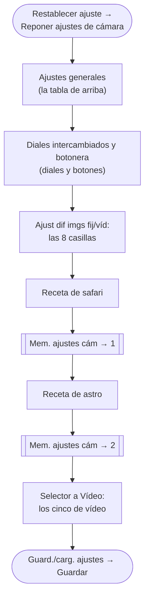

# 1. Configuración básica de la Sony a6700

> 🔵 **Básico** · Da por sabido: los capítulos 0 y 0.5 · Te desbloquea: dejar la cámara lista para el viaje y no volver a configurarla.

> **Todos los ajustes con su ruta exacta de menú, fauna y noche en dos
> columnas**: [la referencia de ajustes](../referencia/ajustes-a6700.md).

> Si vienes del móvil y los términos (obturación, ISO, modo M) aún te bailan,
> empieza por el [capítulo 0](00-de-movil-a-la-a6700.md): 10 minutos y listo.
> Y si lo que te pierde es **el menú** —dónde está cada cosa, cómo se navega,
> cómo se reasigna un botón—, el [capítulo 0.5](00b-menus-y-primer-dia.md) es
> el mapa: este capítulo lo da por sabido.

El objetivo es poder cambiar entre "modo safari" y "modo astro" girando el
dial a las memorias **1/2 (MR)**, sin bucear en menús de noche o con un león
delante.

## Firmware

Actualiza al firmware más reciente desde la página de soporte de Sony:
<https://www.sony.es/electronics/support> (busca "ILCE-6700" o "a6700"). Los
dos objetivos también tienen firmware, y al ser Sony se actualizan **con el
objetivo montado en la cámara**, conectándola al ordenador por USB con el
actualizador de la misma web de soporte (busca "SEL11F18" y "SEL70350G").
El 70-350 es **prestado**: su dueño ya dio permiso para actualizar el suyo.
Hazlo en casa, con todo cargado, y no vuelvas a pensar en ello.

## Ajustes generales recomendados

| Ajuste | Valor | Motivo |
|---|---|---|
| `Formato archivo` (en `Calid. img/grab.`) | RAW, con `Tipo archivo RAW` comprimido sin pérdida | Máxima latitud de edición |
| `Visualizac. cebra` | **Activar, nivel `100 IRE o +`** | Rayado en vivo sobre lo que va a salir quemado — tu aviso de altas luces *antes* de disparar |
| `RR exposic. larga` | Desactivar | Duplica el tiempo entre fotos de astro |
| `RR ISO Alta` | Desactivar/Baja | Solo afecta al JPEG; en RAW lo harás mejor en el ordenador |
| Señales de audio | OFF | Silencio en charcas y miradores |
| `Liberar sin tarj. mem.` | **Inhabilitar** | De fábrica la cámara dispara sin tarjeta y no guarda nada |
| `Iluminador AF` | **Desactivar** | Su luz naranja espanta a los animales de la charca |
| DRO (optimizador de rango dinámico) | OFF | No toca el RAW, pero maquilla el JPEG y el histograma — engaña justo a lo que usas para exponer |
| `SteadyShot` | **Activar** | Los dos objetivos son Sony con contactos: la cámara sabe la focal sola (`Ajuste SteadyShot` en Auto). En trípode, **Desactivar** |
| Efecto de ajustes en visor/pantalla | ON | Ver la exposición real antes de disparar |

## Enfoque con el pulgar (back-button focus)

El cambio de configuración más útil de la cámara para safari:

1. `MENU → Enfoque → [AF/MF] → [AF c/obturador] → Desactivar` (quita el AF del
   disparador).
2. El botón **AF-ON** ya inicia el enfoque de serie: no hay que tocarlo.

Resultado: enfocas con el pulgar (AF-ON) y disparas con el índice, por
separado. Para reencuadrar o esperar el momento sin que la cámara reenfoque
al arbusto, es oro. Practícalo en casa hasta que sea automático.

## Los diales: intercámbialos antes que nada

De fábrica, en M, el **dial delantero mueve la apertura** y el trasero la
velocidad. Todo este repo dice "obturación = rueda delantera", porque es lo
que tocas en el safari y el índice es el dedo rápido. Así que:
`MENU → Ajustes → [Personal. operac.] → [Ajuste t. pers./dial]` →
**`Dial frontal` = `Velocidad obturador`** y **`Dial trasero` = `Abertura`**.
Compruébalo: en M, el delantero mueve la velocidad. La botonera completa
(C1, C3, el Fn, el bloqueo y el táctil) está en
[diales y botones](00c-diales-y-botones.md).

## Otros botones útiles

- **La compensación de exposición, a mano**: de serie vive en la flecha
  **inferior** de la rueda de control. Las recetas de safari la usan a diario
  (funciona también en M con ISO Auto); si prefieres girar una rueda sin
  soltar el agarre, asígnala a la que quede libre en M desde
  `MENU → Ajustes → [Personal. operac.] → [Ajuste t. pers./dial]`
  ([capítulo 0.5](00b-menus-y-primer-dia.md)).
- **`Verificac. luminosa` en un botón custom** (*Bright Monitoring* en
  inglés): en `MENU → Ajustes → [Personal. operac.] → [Ajuste t. pers./dial]`,
  asígnala a C1. No está en ningún menú: solo existe como función de botón,
  y solo funciona con el enfoque en MF.
  Amplifica la pantalla en plena oscuridad para poder **componer la Vía Láctea viéndola** — la joya
  nocturna de esta cámara ([capítulo 2](02-astrofotografia-namibia.md)).
- **Botón Fn**: la pantalla rápida con los ajustes del día a día, editables.
- **Pantalla táctil**: toca al animal y el seguimiento se engancha a él;
  vuelve a tocar para soltarlo.
- **Los botones de los objetivos**: tanto el 11 mm como el 70-350 llevan un
  **botón de retención de foco** en el barrilete (de serie congela el
  enfoque mientras lo mantienes) y un **interruptor AF/MF**. El botón es
  reasignable desde el mismo `[Ajuste t. pers./dial]` — a un novato le
  renta dejarlo como viene.

## Vídeo: los cinco ajustes que se ponen una vez

El selector **Foto / Vídeo / S&Q** puede llevar el vídeo aparte de la foto,
así que esto se pone una vez y se queda — sin gastar ninguna memoria del dial
y sin tocar el modo safari. **Paso cero, antes que nada**:
`Ajustes → [Personal. operac.] → [Ajust dif imgs fij/víd]`, marca **las ocho casillas** (Abertura, Velocidad obturador, ISO,
Compensar exp., Modo medición, Balance blanco, Perfil de imagen y Modo de
enfoque) y acepta. Sin eso, esos ocho son **comunes** a foto y vídeo y el
1/50 del vídeo te aparecería en la foto. (Hazlo antes de configurar: si
algún día las desmarcas, vuelven a los valores iniciales.)

| Ajuste | Valor | Motivo |
|---|---|---|
| `Selector NTSC/PAL` | **PAL** | Es lo que habilita los 25p europeos. Con una tarjeta formateada en el otro sistema, la cámara puede pedir **reformatearla**: hazlo en casa, nunca en el viaje |
| Formato de archivo / ajustes de grabación | XAVC S 4K · **25p · 100 Mbps** | Calidad de sobra y archivos manejables (~45 GB/hora) |
| Modo de exposición (en Vídeo) | **M con ISO Auto**, obturación **1/50** | La "regla del 180°": movimiento natural |
| Perfil de imagen | **OFF** | S-Log3 obliga a etalonar en casa; no es para este viaje |
| SteadyShot (película) | **Activo** | Estabilización extra para andar grabando (recorta 1,1x) |

El resto —encuadre, audio, cómo se sujeta y qué grabar— está en
[el vídeo del viaje](../tecnica/video-del-viaje.md), con
[chuleta imprimible](../tecnica/chuleta-video.md).

## Memorias del dial: MR1 y MR2

El orden importa: lo que guardas en una memoria es **lo que hay puesto en ese
momento**, así que primero lo común y después cada receta.

Configura la cámara como quieras que quede y guárdala con
`MENU → Toma → [Modo de toma] → [Mem. ajustes cám]` (*Camera Set. Memory*) → 1 o 2:

- **MR1 — Safari diurno**: M, 1/1000 s, apertura mínima del zoom,
  ISO Auto (100–12800), AF-C, reconocimiento de sujeto **Animal**, área
  Zona, ráfaga Hi+ (11 fps), RAW.
- **MR2 — Astro**: M, 20 s, **f/1.8**, ISO 1600, balance de blancos K 3900,
  enfoque manual, temporizador 2 s, SteadyShot OFF, RAW. Con el 11 mm la
  apertura sí se guarda en la memoria (es un objetivo con contactos): al
  girar el dial a 2 la noche entera queda puesta de una vez.

**Ojo**: las memorias vuelven a lo guardado al reactivarlas; si ajustas algo
sobre la marcha (p. ej. subes el ISO en la charca) y giras el dial, al
volver a la memoria recupera lo guardado. Es una ventaja: nunca heredas
ajustes raros de la noche anterior. Para hacer fijo un cambio, vuelve a
guardar. Caben 3 memorias en la cámara y 4 más (M1–M4) en la tarjeta.

## Una sola tarjeta: el plan de copias

La a6700 tiene **una sola ranura SD** — no existe la segunda tarjeta espejo,
así que la segunda copia es el **volcado de cada noche** al MacBook (con el
lector UHS-II, y al SSD si lo llevas), y las tarjetas llenas **no se
reutilizan** mientras haya otra con hueco: volcadas y comprobadas, son la
otra copia. Compra la tarjeta rápida (**UHS-II**, V60 va sobrada) para que
las ráfagas en RAW no se atasquen. El sistema completo de copias del viaje
está en la [guía de logística](../campo/logistica-viaje.md).

## Si la cámara está en inglés

| Español (este tutorial) | Inglés (menú) |
|---|---|
| Obturación | Shutter speed |
| Apertura | Aperture |
| AF continuo | AF-C / Continuous AF |
| Enfoque manual directo | DMF |
| Reconocimiento de sujeto | Subject Recognition |
| Punto | Spot |
| Zona | Zone |
| Seguimiento | Tracking |
| Ráfaga Hi | Cont. Shooting: Hi |
| Balance de blancos | White balance |
| Mem. ajustes cám | Camera Set. Memory |
| Func. capt. interv. (intervalómetro) | Interval Shoot Func. |
| Selector NTSC/PAL | NTSC/PAL Selector |
| Perfil de imagen | Picture Profile |
| Retención de enfoque | Focus Hold |
| Ajuste SteadyShot | SteadyShot Adjust |
| Nivel | Level |
| Verificac. luminosa | Bright Monitoring |
| AF c/obturador | AF w/ shutter |
| Zebra | (igual en ambos idiomas) |

## Ejercicio (una tarde, en casa)

Este capítulo se aprueba con la cámara en la mano, no leyéndolo:

1. **Firmware** del cuerpo y de los dos objetivos al día, con todo cargado
   (el del 70-350 también: su dueño ya dio permiso).
2. **Los diales intercambiados** (delantero = velocidad) y la botonera de
   [diales y botones](00c-diales-y-botones.md).
3. **La tabla de ajustes generales**, uno a uno, con la
   [referencia de ajustes](../referencia/ajustes-a6700.md) al lado para la
   ruta exacta. Tacha cada fila.
4. **El pulgar**: `AF c/obturador` en Desactivar y cincuenta fotos por
   casa enfocando solo con AF-ON.
5. **MR1 y MR2 guardadas** y comprobadas: gira el dial a 1 y dicta en voz
   alta los valores del visor; a 2, lo mismo. Deben ser los de la tabla.
6. **Los cinco de vídeo** puestos (PAL ya está: formatea ahora, en casa) y
   el selector de vuelta a Foto — comprueba que el modo foto no cambió.
7. Apaga, enciende, y **MR1 → MR2 → MR1 sin mirar** la cámara.

**Aprobado cuando**: cada valor que dicta el visor coincide con la tabla,
el cambio de memoria te sale en menos de cinco segundos a ciegas, y no
vuelves a tocar el menú hasta el viaje. (Los ejercicios 1–10 de
[qué practicar con el 11 mm](../plan/ejercicios-11mm.md) son la versión
larga de esto.)

## Si algo no cuadra…

| Problema | Solución |
|---|---|
| No encuentro un ajuste en los menús | Botón **Fn**: casi todo lo del día a día está en esa pantalla, editable |
| Cambié algo en MR1/MR2 y al volver ha desaparecido | Es su diseño: las memorias recuperan lo GUARDADO. Para hacer fijo un cambio, vuelve a guardar (`Mem. ajustes cám`) |
| AF-ON no enfoca tras configurar el pulgar | Revisa los dos pasos: `AF c/obturador` = Desactivar y la asignación de AF-ON sin tocar |
| El estabilizador "flota" o emborrona | SteadyShot ON sobre trípode: apágalo (en el cuerpo y, con el tele, también su interruptor OSS) |
| Un objetivo "no enfoca" de repente | Su interruptor **AF/MF** se movió en la mochila: los dos lo llevan en el barrilete |
| El visor no se enciende al acercar el ojo | La pantalla está desplegada hacia ti o el selector visor/pantalla está en manual: pliégala o ponlo en Auto |
| El menú está en inglés y me pierdo | La tabla de traducción de arriba; o `Menu → Language → Español` |

## Referencias

- Help Guide oficial de la a6700 (manual completo en línea): <https://helpguide.sony.net/ilc/2320/v1/es/>
- Soporte oficial Sony (firmware y manuales): <https://www.sony.es/electronics/support>
- Sony E 11mm F1.8 (SEL11F18), ficha oficial: <https://www.sony.es/lenses/products/sel11f18>
- Sony E 70-350mm F4.5-6.3 G OSS (SEL70350G), ficha oficial: <https://www.sony.es/lenses/products/sel70350g>
