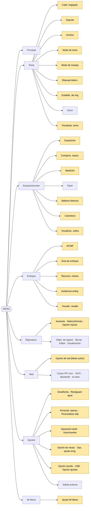

# El menú completo de la a6700 — pestaña a pestaña, con tu valor

> 🟢 **Iniciación** · Da por sabido: nada (el [capítulo 0.5](../a6700/00b-menus-y-primer-dia.md) enseña a moverse; aquí basta con saber que MENU abre y vuelve atrás) · Te desbloquea: saber qué es **cada** línea del menú, cuáles importan en este viaje y cuáles puedes ignorar sin culpa.

[La referencia de ajustes](ajustes-a6700.md) recoge los ajustes que **usa**
este viaje, con su valor de fauna y de noche. Esta página es lo contrario: el
menú **entero**, pestaña a pestaña y grupo a grupo, tal como aparece en la
cámara con el selector en **Foto**. Cada línea lleva una frase de qué hace y
**qué valor le das tú**. Cuando el valor es "no lo toques", es que no pinta
nada en Namibia: puedes pasar de largo.

Todos los nombres están copiados de la **Guía de ayuda oficial de Sony en
español** (auditoría de octubre de 2026, página por página). Salen
**abreviados como en la pantalla** (`Calid. img/grab.`, `Ajust dif imgs fij/víd`):
así los vas a leer en la cámara, no los "corrijas". Sony no publica los
valores de fábrica en la Guía, así que la columna es **tu valor**, no el de
fábrica.

## La receta rápida: las 15 líneas que hay que cambiar sí o sí

Si solo tienes media hora, cambia esto y olvídate del resto de la página:

| # | Ruta | Valor | Por qué |
|---|---|---|---|
| 1 | `Toma → [Calid. img/grab.] → [Formato archivo]` | **RAW** | Todo el revelado del repo asume RAW |
| 2 | `Toma → [Calid. img/grab.] → [Tipo archivo RAW]` | **C. sin pérd.** | Máxima calidad (el búfer baja a 23: [equipo](../a6700/05-equipo-accesorios.md)) |
| 3 | `Toma → [Calid. img/grab.] → [RR exposic. larga]` | **Desactivar** | Si no, cada foto de 20 s va seguida de 20 s en negro |
| 4 | `Toma → [Obturad./silenc.] → [Liberar sin tarj. mem.]` | **Inhabilitar** | Si no, la cámara **dispara sin tarjeta y no guarda nada** |
| 5 | `Toma → [Visualizac. toma] → [Vis. lín. cuadrícul.]` | **Activar** (`Cuadr. regl. terc.`) | Aire de la mirada y horizontes rectos |
| 6 | `Exposición/color → [Visualizac. cebra] → [Visualizac. cebra]` | **Activar**, nivel **`100 IRE o +`** | Tu alarma de quemados en vivo |
| 7 | `Exposición/color → [Color/tono] → [Opt. gama diná.]` | **Desactivar** | Maquilla la pantalla y el histograma, que es lo que usas para exponer |
| 8 | `Enfoque → [AF/MF] → [AF c/obturador]` | **Desactivar** | Enfoque con el pulgar (AF-ON) |
| 9 | `Enfoque → [AF/MF] → [Iluminador AF]` | **Desactivar** | Esa luz naranja en una charca nocturna espanta animales y vecinos |
| 10 | `Ajustes → [Personal. operac.] → [Ajust dif imgs fij/víd]` | **Las 8 casillas marcadas** | Sin esto, el 1/50 del vídeo aparece en tus fotos |
| 11 | `Ajustes → [Personal. operac.] → [Ajuste t. pers./dial]` | **Dial frontal = velocidad, dial trasero = abertura** | De fábrica es al revés, y todo el repo dice "rueda delantera = obturación" ([diales y botones](../a6700/00c-diales-y-botones.md)) |
| 12 | `Ajustes → [Opción de visual.] → [Rev.automática]` | **Desactivar** | Te tapa el visor justo cuando la escena sigue |
| 13 | `Ajustes → [Opción de visual.] → [Visual. tomas rest.]` | **Mostrar siempre** | Ves cuántas fotos te quedan en el búfer antes de que la ráfaga se atasque |
| 14 | `Ajustes → [Opción sonido] → [Señales audio]` | **Desactivar** | Silencio en charcas y miradores |
| 15 | `Ajustes → [Opción ajustes] → [Asign. auto. píxeles]` | **Activar** | Limpia los píxeles calientes al apagar: en astro se ven como puntos rojos |

Y al acabar, guarda todo en la tarjeta como copia:
`Ajustes → [Rest/guard ajust] → [Guard./carg. ajustes] → Guardar` (abajo,
en "Ajustes").

## Cómo leer las tablas

- **Ruta**: `MENU → pestaña → [grupo] → [ajuste]`. Las tablas van por grupo,
  así que la ruta completa es "la pestaña del título + el grupo de la tabla".
- **Tu valor**: lo que se pone para el viaje. **Fauna** = la memoria MR1;
  **noche** = charca o MR2; los detalles por escena, en la
  [referencia de ajustes](ajustes-a6700.md).
- 🎥 = solo existe en vídeo; ⚠️ = se lleva por delante otra cosa (lo dice la
  columna).
- El menú **cambia con el selector Foto / Vídeo / S&Q**: si una línea no
  aparece, mira el selector antes de buscar más. Lo de vídeo va al final.

## El mapa: ocho pestañas y sus grupos

En **amarillo**, los grupos donde vas a tocar algo para este viaje; los
demás existen, pero puedes pasar de largo.

---

## Pestaña Principal

No tiene grupos: es una **lista de lo que tienes puesto ahora mismo**
(velocidad, abertura, compensación, ISO, formato, tipo de RAW, modo de toma,
modo de manejo, balance, enfoque, área, batería…). Tocar cualquier valor
abre su ajuste para cambiarlo. Úsala como **repaso de diez segundos** antes
de la primera foto del día: si algo no cuadra con la
[chuleta](../a6700/chuleta.md), se ve aquí de un vistazo.

---

## Pestaña Toma

### [Calid. img/grab.]

| Ajuste | Qué hace | Tu valor |
|---|---|---|
| `Conm JPEG/HEIF` | Elige si la foto procesada es JPEG o HEIF | **JPEG** (en RAW no importa; el HEIF da guerra en muchos programas) |
| `Formato archivo` (foto) | RAW, RAW & JPEG o JPEG | **RAW** |
| `Tipo archivo RAW` | `C. sin pérd.` o `Comprimido` | **C. sin pérd.** (el comprimido baja a 12 bits en ráfaga) |
| `Calidad JPEG` · `Tamañ img JPEG` | Compresión y tamaño del JPEG | No lo toques: en RAW no hay JPEG |
| `Relación aspecto` | 3:2, 4:3, 16:9, 1:1 | **3:2**. El RAW es siempre 3:2: el recorte se decide en casa |
| `Formato archivo` (película) · `Ajustes de vídeo` | Formato y tasa del vídeo (se ven también en Foto) | Ver "Vídeo", al final |
| `RR exposic. larga` | Reducción de ruido en exposiciones de 1 s o más: dobla el tiempo de cada foto | **Desactivar** ⚠️ con ella activa no hay star trails |
| `RR ISO Alta` | Reducción de ruido a ISO alto | **Desactivar** o **Bajo** (solo afecta al JPEG) |
| `Imágenes fij. HLG` | Fotos HDR en HEIF | **Desactivar** |
| `Rango color` | sRGB o AdobeRGB | **sRGB** (en RAW no cambia nada; el JPEG se ve bien en todas partes) |
| `Compens. objetiv.` | Sombras de esquina, aberración cromática y distorsión | **Automático** en las tres. `Compens. variación` es solo de vídeo |

### [Soporte]

| Ajuste | Qué hace | Tu valor |
|---|---|---|
| `Formatear` | Borra la tarjeta **entera**, incluidas las memorias M1–M4 | Cada tarjeta **nueva**, en casa. **Nunca en el viaje**: las llenas son tu segunda copia ([logística](../campo/logistica-viaje.md)) |
| `Recuper. BD imág` | Repara el índice de la tarjeta si la cámara dice que algo no cuadra | Solo si sale un aviso de base de datos |
| `Ver info soporte` | Cuántas fotos y minutos de vídeo caben en lo que queda | **Mírala en el volcado de cada noche**: te dice cuánto aguanta la tarjeta mañana |

### [Archivo]

| Ajuste | Qué hace | Tu valor |
|---|---|---|
| `Aj. archiv./carpet.` → `Número archivo` | `Serie` sigue la numeración al cambiar de tarjeta; `Reponer` vuelve a 0001 | **Serie**: con cuatro tarjetas, `Reponer` te da cuatro `DSC00001` que se pisan al copiar |
| `Aj. archiv./carpet.` → `Nombre carpeta` | Carpetas normales o por fecha | **Forma fecha**: el volcado nocturno sale ordenado por día solo |
| `Selec. carpeta grab.` · `Carpeta nueva` | Elegir o crear carpetas | No lo toques |
| `Inform. de copyright` | Escribe tu nombre en cada foto | **Activar** y pon tu nombre: dos minutos, y cada foto lleva autor |
| `Inscrib. núm. serie` | Escribe el número de serie de la cámara en el archivo | **Activar**: si roban la cámara, las fotos prueban cuál era |

### [Modo de toma]

| Ajuste | Qué hace | Tu valor |
|---|---|---|
| `Autom./sel. escena` | Qué hace el dial en AUTO | No lo toques (no usas AUTO) |
| `Recup. ajust. cám.` | Recupera una memoria (1–3 del dial, M1–M4 de la tarjeta) | Las del dial se recuperan girándolo; esto solo para M1–M4 |
| `Mem. ajustes cám` | **Guarda** lo que tienes puesto en 1, 2 o 3 | **1 = safari · 2 = astro · 3 = aves** ([capítulo 1](../a6700/01-configuracion-basica.md)). Cada modo (foto, vídeo, S&Q) tiene sus tres propias |
| `Reg ajuste toma pers` | Ajustes que solo valen mientras mantienes pulsado un botón | No lo toques (nivel avanzado: [AF a fondo](../mejora/af-y-exposicion-a-fondo.md)) |

### [Modo de manejo]

| Ajuste | Qué hace | Tu valor |
|---|---|---|
| `Modo manejo` | Una foto, ráfaga, temporizador u horquillados | **Fauna**: `Captura contin.` en **Hi+** (~11 fps; ~10 en RAW sin pérdida). **Astro**: `Autodisp.(senc)` de **2 s**. También está en la flecha izquierda de la rueda |
| ↳ `Captura contin.` | Hi+ ~11 fps · Hi ~8 · Mid ~6 · Lo ~3 | Hi+. En Hi+ el visor no va en vivo durante la ráfaga: si te cuesta seguir, Hi |
| ↳ `Variación expos.` | Horquillado de exposición | Para paisaje con mucho contraste ([paisaje a fondo](../mejora/paisaje-a-fondo.md)). En M con ISO AUTO varía el ISO |
| ↳ `Var.exp. enfoque` | Horquillado de enfoque (apilado) | No lo toques |
| `Ajustes de Variación` | Orden y temporizador del horquillado | No lo toques |
| `Func. capt. interv.` | **El intervalómetro integrado**: inicio, intervalo (1–60 s, de inicio a inicio), número de tomas (hasta 9.999) | Star trails: 30 s · intervalo **31 s** · 90–180 tomas. Timelapse: 15 s · **17 s** · 300 ([capítulo 2](../a6700/02-astrofotografia-namibia.md)) |
| ↳ `Tipo obturad. interv.` | Obturador de la serie a intervalos (de fábrica, **electrónico**, sea cual sea el de la cámara) | **Obturad. electr.**: silencioso y sin desgaste. Hasta 30 s, de sobra para astro |

### [Obturad./silenc.]

| Ajuste | Qué hace | Tu valor |
|---|---|---|
| `Aj. modo silenc.` | Silencio total de golpe: fuerza electrónico y apaga los pitidos | **Desactivar**: en la charca basta con `Tipo de obturador` |
| `Tipo de obturador` | Mecánico (1/4000–30 s y BULB) o electrónico (1/8000–30 s, sin BULB) | **Mecánico de día**; **electrónico en la charca** (silencio absoluto). ⚠️ el electrónico desactiva BULB y `RR exposic. larga`, y con LED parpadeantes puede sacar franjas |
| `e-Prim. cortin. obtur.` | Primera cortinilla electrónica: menos retardo | **Activar**. Desactívala solo si a 1/4000 con el 11 mm a f/1.8 ves el bokeh recortado |
| `Liber. sin objetivo` | Disparar sin objetivo montado | **Inhabilitar** (tus dos objetivos tienen contactos) |
| `Liberar sin tarj. mem.` | Disparar sin tarjeta (la foto no se guarda) | **Inhabilitar** ⚠️ Sony lo trae habilitado |
| `Ajust. sin parpadeo` | Reduce las franjas de luces artificiales (solo con obturador mecánico) | **Desactivar**; en la charca, si pasas a mecánico por las franjas, actívalo |

### [Estabiliz. de img]

| Ajuste | Qué hace | Tu valor |
|---|---|---|
| `SteadyShot` (foto) | El estabilizador del sensor | **Activar** a pulso, **Desactivar** en trípode. Con el 70-350 **manda su interruptor OSS**: la cámara obedece al objetivo |
| `Adaptac. SteadyS.` | Focal automática o manual | **Automático** (los dos objetivos informan de su focal) |
| `Distanc. focal` | La focal para el modo manual | No lo toques |

### [Zoom]

| Ajuste | Qué hace | Tu valor |
|---|---|---|
| `Zoom` · `Rango del Zoom` | Zoom digital | **Solo zoom óptic.**: ningún zoom digital funciona en RAW, y además apaga el reconocimiento de sujeto |
| `Tecla pers. vel. z.` · `Vel. zoom remota` | Velocidad de zooms motorizados | No lo toques (tus zooms son manuales) |

### [Visualizac. toma]

| Ajuste | Qué hace | Tu valor |
|---|---|---|
| `Vis. lín. cuadrícul.` | Muestra la cuadrícula | **Activar** |
| `Tipo lín. cuadríc.` | Tercios, cuadrada o diagonal | **Cuadr. regl. terc.** |
| `Ajust. vis. en directo` | Si la pantalla refleja la exposición real | **Efecto ajust. act.**: ves la foto antes de hacerla. (`Verificac. luminosa` lo pasa a desactivado mientras la usas: es normal) |

---

## Pestaña Exposición/color

### [Exposición]

| Ajuste | Qué hace | Tu valor |
|---|---|---|
| `Aj. temporiz. BULB` | En BULB, expone un tiempo fijo (2–900 s) | Solo si haces exposiciones de más de 30 s (no hace falta en este viaje) |
| `ISO` | La sensibilidad (ISO 50–102400; de fábrica ISO AUTO va de 100 a 6400) | **Fauna**: ISO AUTO con máximo **12800** (derecha sobre ISO AUTO → `ISO AUTO máximo`). **Charca**: 6400 fijo. **Astro**: 1600. También en la flecha derecha de la rueda |
| `Límite rango ISO` | Limita el ISO **manual** | No lo toques |
| `ISO AUTO VO mín.` | Velocidad a partir de la que sube el ISO (solo en P y A) | No lo toques: en M decides tú la velocidad |

### [Compens. expos.]

| Ajuste | Qué hace | Tu valor |
|---|---|---|
| `Compensar exp.` | Aclara u oscurece: **±5 EV en foto, ±2 EV en vídeo**. En M solo funciona con ISO AUTO | La usas a diario; vive en la flecha inferior de la rueda |
| `Paso exposición` | Pasos de 1/3 o 1/2 | **0,3 EV** (tercios, como en todas las recetas) |
| `Ajuste están. exp.` | Desplaza lo que la cámara considera "bien expuesto" | **No lo toques nunca**: falsea todas las recetas sin avisar |

### [Medición]

| Ajuste | Qué hace | Tu valor |
|---|---|---|
| `Modo medición` | `Multi` · `Centro` · `Puntual` · `Prom. pant. ent.` · `Iluminación` | **Multi**; **Puntual** vinculada en el nivel avanzado ([AF a fondo](../mejora/af-y-exposicion-a-fondo.md)) |
| `Cara en multimed.` | En Multi, mide según las caras | No lo toques |
| `Punto med. punt.` | `Centro` o `Vínc. punto enf.` (el círculo sigue al punto de enfoque) | **Vínc. punto enf.** cuando uses Puntual |
| `AEL con obturad.` | Si medio disparador bloquea la exposición | No lo toques |

### [Flash]

Todo el grupo (`Modo flash`, `Compensac. flash`, `Ajust.comp.exp.`,
`Flash inalámbrico`, `Reducción ojos rojos`, `Ajustes flash externo`,
`Reg. ajust toma flash`) es para un flash que no llevas. **No lo toques**, y
en las charcas el flash está prohibido de todas formas.

### [Balance blancos]

| Ajuste | Qué hace | Tu valor |
|---|---|---|
| `Balance blanco` | Automático, preajustes, `Tem.col./filtro` (en K) y personalizados | **Fauna**: `Luz diurna` o K fijo. **Charca**: K ≈ 3500. **Astro**: K 3900. En `Tem.col./filtro` el dial trasero cambia los K ([balance de blancos](balance-de-blancos.md)) |
| `Ajuste prior AWB` | Qué prioriza el automático con luz cálida | No lo toques |
| `Bloq.AWB dispar.` | Bloquea el automático al disparar | No lo toques |

### [Color/tono]

| Ajuste | Qué hace | Tu valor |
|---|---|---|
| `Opt. gama diná.` | DRO: aclara sombras por zonas en el JPEG | **Desactivar** |
| `Aspecto creativo` | El "estilo" del JPEG (ST, PT, VV, BW…) | **ST**. Solo toca al JPEG y a la pantalla |
| `Perfil de imagen` | Curvas de vídeo (PP1–PP11, S-Log3, HLG) | **Desactivar** en foto; en vídeo, ver al final |
| `Efecto piel suave` | Suaviza la piel de las caras | **Desactivar** |

### [Visualizac. cebra]

| Ajuste | Qué hace | Tu valor |
|---|---|---|
| `Visualizac. cebra` | Raya en pantalla lo que se va a quemar | **Activar** |
| `Nivel de cebra` | 70 a 100, `100 IRE o +` y dos personalizados | **100 IRE o +**: solo raya lo ya perdido |

---

## Pestaña Enfoque

### [AF/MF]

| Ajuste | Qué hace | Tu valor |
|---|---|---|
| `Modo de enfoque` | `AF toma sencilla` (AF-S) · `AF automático` · `AF continuo` (AF-C) · `DMF` · `Enfoque man.` | **Fauna**: AF-C. **Charca**: AF-S. **Astro**: MF. El interruptor AF/MF del objetivo **manda** sobre esto |
| `Ajuste prior en AF-S` · `Ajuste prior en AF-C` | Si dispara sin estar enfocado | No lo toques |
| `Sens. Seguim. AF` | `5(reactivo)` a `1(fijado)`, `3(estándar)` en medio | **3**; **1** con hierba delante; **4–5** en persecución |
| `Iluminador AF` | La luz de ayuda al enfoque | **Desactivar** |
| `Manejo abertura AF` | Cómo mueve el diafragma mientras enfoca | No lo toques |
| `AF c/obturador` | Si el disparador a medias enfoca | **Desactivar** (enfocas con AF-ON) |
| `Enf. m. d. tpo compl.` | El anillo enfoca a mano aunque estés en AF | No lo toques |
| `Pre-AF` | Enfoca antes de que pulses nada | **Desactivar**: gasta batería y no aporta con AF-ON |

### [Área de enfoque]

| Ajuste | Qué hace | Tu valor |
|---|---|---|
| `Área de enfoque` | `Ancho` · `Zona` · `Fijo al centro` · `Punto: S/M/L` · `Punto expandido` · `Seguimiento` (con todas las anteriores; solo en AF-C) | **Fauna**: Zona (o Ancho si la escena está limpia). **Charca**: Punto S o M. Vive en **C2** de fábrica |
| `Lím. área enfoque` | Quita de la lista las áreas que no usas | Deja solo **Ancho, Zona, Punto: M y Seguimiento: Zona**: cambiar de área se vuelve de dos pulsaciones |
| `Conm.áreaAF V/H` | Área distinta en vertical y horizontal | **Desactivar** |
| `Col. cuadro enfoq.` | Blanco o rojo | El que veas mejor (rojo se lee mejor sobre hierba seca) |
| `Registro área AF` · `Borr. área AF reg,` | Guardar una posición de AF para un botón | No lo toques |
| `Desact. Aut. Área AF` · `Vis. área dur seguim.` · `Visual. área AF-C` · `Área detección fase` | Qué cuadros se ven mientras enfoca | No lo toques |
| `Circ. punto enfoq.` | El punto salta de un borde al contrario | No lo toques |
| `Cant mov cdro AF` | Cuánto se mueve el punto por pulsación | No lo toques |

### [Reconoc. motivo]

| Ajuste | Qué hace | Tu valor |
|---|---|---|
| `Rec. motivo en AF` | La cámara busca el ojo sola | **Activar** |
| `Dest. reconocim.` | `Humano` · `Animal/ave` · `Animal` · `Ave` · `Insecto` · `Coche/tren` · `Avión` (con ajustes finos por motivo con la derecha) | **Animal**; **Ave** para aves. Ponlo en el Fn |
| `Aj. conm. dest rec` | Qué motivos recorre la tecla `Conmut. dest. recon.` | Marca solo **Animal, Ave y Humano**: tres saltos en vez de siete |
| `Selecc. ojo d./izq.` | Qué ojo enfoca | **Automático** |
| `Vis. cuadro rec. m.` | Muestra el cuadro del ojo reconocido | **Activar**: es la confirmación de que lo ha encontrado |
| `Registro rostros` · `Priorid. rostro reg.` | Caras registradas | No lo toques |

### [Asistencia enfoq.]

| Ajuste | Qué hace | Tu valor |
|---|---|---|
| `Amplif. autom. MF` | Amplía solo al girar el anillo en MF | **Activar**: en astro, tocar el anillo ya te pone la lupa (y apaga `Verificac. luminosa`, que para entonces ya no necesitas) |
| `Amplific. enfoque` | La lupa para comprobar el foco | Se ejecuta, no se ajusta. Mejor en un botón ([diales y botones](../a6700/00c-diales-y-botones.md)) |
| `Tiemp. aum. enf.` | Cuánto dura la lupa | **Sin límite**: enfocar una estrella lleva su tiempo |
| `Aum. inic. enfoq.` | Aumento inicial (x1,0 o x6,1) | **x6,1** |
| `AF en ampl. enfoq` | AF con la imagen ampliada | No lo toques |

### [Visualiz. resalte]

| Ajuste | Qué hace | Tu valor |
|---|---|---|
| `Visualizac. resalte` | El *peaking*: colorea los bordes enfocados | **Activar** |
| `Nivel de resalte` | Alto, medio o bajo | **Medio** |
| `Color de resalte` | Rojo, amarillo, azul o blanco | El que más contraste con la escena: rojo o amarillo |

---

## Pestaña Reproducc.

| Grupo | Ajuste | Qué hace | Tu valor |
|---|---|---|---|
| `[Objet. de reprod.]` | `Modo visualización` | Agrupar por fecha, carpeta o vídeo | **Ver fecha** |
| `[Aumento]` | `Aumentar` · `Aum. aumento inic` · `Aum. posic. inicial` | Ampliar la foto, con qué aumento y desde dónde | `Aum. posic. inicial` en **Posic. enfocada**: amplía directamente sobre el ojo |
| `[Selección/nota]` | `Proteger` | Blinda fotos contra el borrado | Las dos o tres irrepetibles |
| | `Valoración` | Estrellas de 1 a 5, que Lightroom lee al importar | Las **3 del día**, con tres estrellas |
| | `Ajust. val.(tecl. pers)` | Qué estrellas recorre el botón de valorar | Marca solo **★★★**: una pulsación y listo |
| `[Borrar]` | `Borrar` · `Borrar puls. 2 vec.` · `Confirm.Borrar` | Borrado y su confirmación | `Borrar puls. 2 vec.` en **Desac.** y `Confirm.Borrar` en **1° "Cancelar"**: en este viaje no se borra en cámara |
| `[Editar]` | `Recortar` · `Rotar` · `Toma fotográfica` | Editar en cámara (no funciona con RAW) | No lo toques |
| `[Visualización]` | `Repr. cont. interv.` · `Veloc. repr. interv` · `Diapositivas` | Reproducir seguido una serie de intervalos o un pase | `Repr. cont. interv.` es **un timelapse instantáneo** de tu serie de star trails: compruébala ahí antes de recoger |
| `[Opción reprod.]` | `Índice imágenes` | 9 o 30 miniaturas | **9** |
| | `Mostrar como grupo` | Agrupa ráfagas y series | **Desactivar**: revisas cada foto de la ráfaga |
| | `Rotación visualizac.` | Las verticales, giradas o no | No lo toques |
| | `Vis. cuadro enfoq.` | Muestra dónde enfocó (verde) | **Activar**: ves si el AF cogió el ojo o la rama |
| | `Visual. img h especif.` | Salta a una fecha y hora | No lo toques |
| | `Ajuste salto imagen` | Cuánto salta cada dial en reproducción | Dial frontal **Una por una**; dial trasero **Solo valor.** (salta entre tus marcadas) |

---

## Pestaña Red

| Grupo | Lo que hay | Tu valor |
|---|---|---|
| `[Conex./PC rem.]` | `Conex. smartphone` (emparejar Creators' App), `Sel. en cám. y env.`, `Conex. dur. APAG.`, toma remota y PC remoto | Empareja **una vez en casa** ([apps](apps-del-viaje.md)). `Conex. dur. APAG.` en **Desactivar**: con la cámara apagada sigue gastando batería |
| `[Transmitir]` | La cámara como webcam por USB | No lo toques |
| `[Creators' Cloud]` | Subir a la nube de Sony | **Desactivar** (no hay red en el viaje) |
| `[Wi-Fi]` · `[Bluetooth]` · `[LAN con cable]` · `[USB-LAN/c. con.]` | Conexiones | Bluetooth y wifi **apagados** salvo cuando uses Creators' App |
| `[Opción de red]` | **`Modo avión`**, nombre del dispositivo, certificados, autenticación, `Restablecer conf. red` | `Modo avión` en **Activar** en el avión, y cuando quieras ahorrar batería |

La a6700 **no tiene GPS ni menú de ubicación**: la posición la pone el móvil
desde Creators' App por Bluetooth, si lo activas allí.

---

## Pestaña Ajustes

### [Área/fecha]

| Ajuste | Qué hace | Tu valor |
|---|---|---|
| `Idioma` | Idioma de los menús | Español (si la cámara sale en inglés, busca *Language* en la pestaña de ajustes, la de la maleta de herramientas) |
| `Aj. área/fecha/hora` | Zona, horario de verano, fecha y hora | Hora de **Namibia** el día que aterrices |
| `Selector NTSC/PAL` | Sistema de vídeo | **PAL**, en casa. Con una tarjeta formateada en el otro sistema puede pedir reformatearla |

### [Rest/guard ajust]

| Ajuste | Qué hace | Tu valor |
|---|---|---|
| `Restablecer ajuste` | `Reponer ajustes de cámara` (los de toma) o `Inicializar` (todo) | Antes de configurar desde cero. **Ninguno borra fotos** |
| `Guard./carg. ajustes` | Guarda tu configuración en la tarjeta (hasta 10) o la carga | **Guardar** al terminar de configurar, y copia el archivo de la tarjeta al móvil o al SSD: si algo se desconfigura en Etosha, lo recuperas en un minuto con `Cargar` |

### [Personal. operac.]

| Ajuste | Qué hace | Tu valor |
|---|---|---|
| `Ajuste t. pers./dial` (foto) · (vídeo) | Qué hace cada botón y cada dial | La botonera completa está en [diales y botones](../a6700/00c-diales-y-botones.md) |
| `Aj. Tecla person.` | Los botones en reproducción | `Valoración` a un botón |
| `Ajustes del menú Fn` | Las 12 casillas del Fn (foto y vídeo por separado) | Las doce de [diales y botones](../a6700/00c-diales-y-botones.md) |
| `Ajust dif imgs fij/víd` | Qué ajustes van aparte en foto y en vídeo | **Las ocho marcadas**: Abertura, Velocidad obturador, ISO, Compensar exp., Modo medición, Balance blanco, Perfil de imagen, Modo de enfoque |
| `Aj. DISP (vis. pant.)` | Qué vistas recorre DISP, en `Monitor` y en `Visor` | Solo **Mostrar toda info.**, **Histograma** y **Nivel** |
| `REC bot. disparad.` 🎥 | Grabar vídeo con el disparador | No lo toques (graba el botón MOVIE) |
| `Rotación anillo zoom` | Solo zooms motorizados | No lo toques |

### [Personalizar dial]

| Ajuste | Qué hace | Tu valor |
|---|---|---|
| `Ajuste t. pers./dial` | El mismo de arriba, repetido aquí | — |
| `Ajustes de Mi dial` | Tres juegos alternativos de funciones para los diales, que llamas con un botón | No lo toques (nivel avanzado) |
| `Rotación de Av/Tv` | Sentido de giro al cambiar velocidad y abertura | **Normal** |
| `Bloqueo dial/rueda` | Con `Bloquear`, mantener **Fn** bloquea los diales y la rueda | **Bloquear**: en la mochila o en el trípode de astro, mantienes Fn y nadie te mueve los 20 s. Y **MENU + Fn 5 s** bloquea todo salvo el disparador |

### [Operación táctil]

| Ajuste | Qué hace | Tu valor |
|---|---|---|
| `Operación táctil` | Táctil sí o no | **Activar** |
| `Pantall./almoh. táctil` | Pantalla táctil, panel táctil con el ojo en el visor, o ambos | **Ambos válidos** |
| `Ajust. pantalla táctil` → `Func. táctil dur. toma` | Qué hace tocar la pantalla: `Enfoque táctil`, `Seguimient. táct.`, `Obturador táctil`, `AE táctil` | **Seguimient. táct.**: tocas al animal y el AF se le pega |
| `Ajust. pantalla táctil` → deslizar y menús | Deslizar arriba = Fn; táctil en reproducción y en menús | Deslizar hacia arriba = **Abrir el menú Fn**; reproducción y menús en **Activar** |
| `Ajust. almohad.táctil` | El panel táctil con el visor (posición absoluta o relativa) | **Posición relativa**: arrastras el punto como en un portátil, sin que salte |

### [Visor/monitor]

| Ajuste | Qué hace | Tu valor |
|---|---|---|
| `Sel. visor/monitor` | Cambio automático por el sensor de ojo | **Automático** |
| `Brillo de monitor` | Manual (−2 a +2) o `Tpo soleado` | **Manual 0** de día (`Tpo soleado` te engaña: todo parece mejor expuesto); **−2** de noche, para no perder la visión nocturna |
| `Brillo del visor` | Automático o manual | **Manual 0**, por la misma razón |
| `Temper. color visor` | Visor más cálido o frío | No lo toques |
| `Calidad visual` | Alta o estándar | **Estándar**: Alta gasta más batería sin cambiar la foto |
| `Vel. transm. visor` | Visor más fluido | **Alto** si sigues aves en vuelo y te va bien de batería; si no, Estándar |
| `Dir. volteo monitor` | Orientación con la pantalla girada | No lo toques |

### [Opción de visual.]

| Ajuste | Qué hace | Tu valor |
|---|---|---|
| `Ajust. visual. TC/UB` · `Asist. visual. Gamma` · `T.asist. vis. Gamma` · `Visualizar LUT` | Ayudas de vídeo profesional | No lo toques |
| `Visual. tomas rest.` | Fotos que caben aún en el búfer durante la ráfaga | **Mostrar siempre** |
| `Rev.automática` | Muestra la foto tras disparar | **Desactivar** |
| `Pant. sel. modo toma` | Pantalla de elección en AUTO y S&Q | No lo toques |

### [Opc. ajuste enrg.]

| Ajuste | Qué hace | Tu valor |
|---|---|---|
| `DESACT mon. aut.` | Apaga la pantalla si no la usas | No lo toques: en una espera larga en la charca no quieres que se apague sola |
| `Hora inic. ahor. ener.` | Cuándo entra en reposo | **1 min.**: despierta al instante con medio disparador, y la batería lo agradece |
| `Ahorr. en. con mon.` | Reposo al cerrar la pantalla | No lo toques |
| `Temp. APAGA auto` | A qué temperatura se apaga sola | **Estándar**. **Alto** solo en trípode (Sony avisa de quemaduras a pulso) |

### [Opción sonido]

| Ajuste | Qué hace | Tu valor |
|---|---|---|
| `Señales audio` | Los pitidos | **Desactivar** |
| `Ajustes de volumen` · `Monit. sonido 4ch` | Volumen y canales al reproducir vídeo | No lo toques |

### [USB]

| Ajuste | Qué hace | Tu valor |
|---|---|---|
| `Modo conexión USB` | Qué hace la cámara al conectarla | No lo toques: el volcado se hace con el **lector**, no con la cámara |
| `Ajuste USB LUN` | Compatibilidad | No lo toques |
| `Alimentación USB` | Alimentar la cámara por USB | **Activar**: con el power bank la cámara aguanta una serie larga de astro |

### [Salida externa]

`Resolución HDMI`, `Aj. salida HDMI`, `Mostrar infor. HDMI` y `CTRL.POR HDMI`:
para monitores y grabadores externos. **No lo toques.**

### [Opción ajustes]

| Ajuste | Qué hace | Tu valor |
|---|---|---|
| `Modo luz de vídeo` | Para una luz LED de Sony | No lo toques |
| `Limpieza del sensor` | Vibra el sensor para soltar polvo (con un 51 % de batería o más) | **El primer remedio** si ves una mancha fija en el cielo: antes que la pera ([limpieza](../campo/limpieza-en-campo.md)) |
| `Asign. auto. píxeles` | Mapeo automático de píxeles calientes al apagar | **Activar** |
| `Asignación píxeles` | El mismo mapeo, ahora | **Ejecútalo antes de volar**, y en el viaje si aparecen puntos de color fijos en las fotos de noche |
| `Versión` | Firmware del cuerpo y del objetivo montado | Compruébalo con cada objetivo antes de volar ([capítulo 1](../a6700/01-configuracion-basica.md)) |
| `Mostr. núm. de serie` | El número de serie | **Fotografíalo** para el seguro |

---

## Pestaña Mi Menú

| Ajuste | Qué hace | Tu valor |
|---|---|---|
| `Añadir elemento` | Añade un ajuste (hasta 42; nada de reproducción) | Los siete de abajo |
| `Ordenar elemento` | Los recoloca | En el orden en que los tocas |
| `Borrar un elemento` · `Borrar una página` · `Borrar todo` | Quitar | — |
| `Mostrar de Mi Menú` | MENU abre directamente aquí | **Activar** |

Los siete que valen la pena: `Sens. Seguim. AF`, `Dest. reconocim.`,
`Área de enfoque`, `Tipo de obturador`, `Func. capt. interv.`,
`Mem. ajustes cám` y `Ver info soporte`.

---

## Vídeo: lo que cambia con el selector en Vídeo o S&Q

Al girar el selector desaparecen las líneas de foto (formato RAW, `Modo manejo`,
`Func. capt. interv.`, `Tipo de obturador`, `RR exposic. larga`…) y aparecen
estas. La receta y el porqué, en [el vídeo del viaje](../tecnica/video-del-viaje.md).

| Dónde | Ajuste | Tu valor |
|---|---|---|
| `Toma → [Calid. img/grab.]` | `Formato archivo` (película) | **XAVC S 4K** (Sony pide tarjeta **V60** para cualquier 4K: las tuyas valen) |
| | `Ajustes de vídeo` | **25p · 100M 4:2:0 8bit** (~45 GB/hora) |
| | `Aj. cám. len+ráp` (S&Q) | Solo si haces cámara lenta: exige **V90** con el proxy apagado; a 100 fps en 4K recorta ~1,6x y a 200 fps solo va en HD |
| | `Ajust. time-lapse` | Los timelapses los hace el Pixel o `Func. capt. interv.` en foto |
| | `Ajuste de toma Log` · `Ajustes proxy` | **Desactivar** los dos |
| `Toma → [Grabac. sonido]` | `Grabación de sonido` · `Nivel grabac. audio` · `Reducc. ruido viento` | Sonido **Activar**; `Reducc. ruido viento` en **Automático** (y el peluche, que es lo que de verdad funciona) |
| `Toma → [Estabiliz. de img]` | `SteadyShot` (película): `Activo` · `Estándar` · `Desactivar` | **Activo** andando (recorta un poco) · **Estándar** parado · **Desactivar** en trípode |
| `Toma → [Opción de toma]` | `Autodisparador` (película) · `Ajust. encuadre auto` | No lo toques |
| `Toma → [Visual. marcador]` | Marcas de encuadre en pantalla | No lo toques |
| `Exposición/color → [Exposición]` | `Auto obtur. lento` | No pinta en M |
| `Exposición/color → [Compens. expos.]` | `Compensar exp.` | Ojo: en vídeo solo llega a **±2 EV** |
| `Exposición/color → [Balance blancos]` | `WB sin vibracion.` | No pinta con K fijo |
| `Exposición/color → [Color/tono]` | `Perfil de imagen` · `Seleccionar LUT` | Perfil **Desactivar** (o PP11 S-Cinetone si quieres color de cine sin editar); LUT, no lo toques |
| `Enfoque → [AF/MF]` | `Vel. transición AF` · `S. camb motiv. AF` · `Ayuda de AF` | Transición **2–3** (lenta, sin saltos bruscos); el resto, no lo toques |
| `Enfoque → [Asistencia enfoq.]` | `Mapa de enfoque` | No lo toques |

## Si algo no cuadra…

| Problema | Es… | Haces… |
|---|---|---|
| Una línea de esta página no sale en tu cámara | El selector Foto / Vídeo / S&Q está en otro modo | Ponlo en Foto (las de vídeo, al revés) |
| La línea sale **en gris** | La bloquea otro ajuste (p. ej. `RR exposic. larga` con obturador electrónico, o BULB con `Captura contin.`) | Mira la nota de la propia pantalla: suele decir cuál la bloquea |
| No sé qué hace la línea que tengo delante | — | Pulsa **C3** (el de la papelera) con ella seleccionada: sale la **Guía en la cámara** |
| Disparé y no se guardó nada | `Liberar sin tarj. mem.` en Habilitar, y la tarjeta en casa | **Inhabilitar** (receta rápida, línea 4) |
| Mis fotos salen a 1/50 sin haberlo tocado | Grabaste vídeo y `Ajust dif imgs fij/víd` no tiene marcada la velocidad | Las ocho casillas, y vuelve a poner la velocidad de foto |
| Gira el dial delantero y se mueve la apertura | Es el reparto de fábrica | Cámbialo en `Ajuste t. pers./dial` ([diales y botones](../a6700/00c-diales-y-botones.md)) |
| Lo he desconfigurado todo | — | `Guard./carg. ajustes → Cargar` si guardaste; si no, `Restablecer ajuste → Reponer ajustes de cámara` y la receta rápida de arriba |

## Ejercicio: el repaso del menú (una tarde, en casa)

1. Abre esta página al lado de la cámara y recorre las pestañas **en orden**,
   grupo a grupo. Cada línea con un valor en **negrita**, ponla; cada "no lo
   toques", léela y pasa.
2. Para cada línea que no entiendas, pulsa **C3** con ella seleccionada y lee
   la Guía en la cámara.
3. Haz la **receta rápida** entera y guarda con `Guard./carg. ajustes →
   Guardar`. Copia el archivo de la tarjeta al móvil.
4. Prueba la copia: `Restablecer ajuste → Reponer ajustes de cámara`, luego
   `Guard./carg. ajustes → Cargar`, y comprueba en la pestaña **Principal**
   que todo volvió.

**Aprobado cuando**: recuperas tu configuración completa desde la tarjeta en
menos de dos minutos, y sabes decir para qué sirve cualquier grupo del menú
que te señalen al azar.

## Referencias

- Guía de ayuda oficial de la a6700 (todo el manual en línea): <https://helpguide.sony.net/ilc/2320/v1/es/>
- La lista completa de menús, con qué sale en foto, vídeo o ambos: <https://helpguide.sony.net/ilc/2320/v1/es/contents/221h_list_of_menu_items_ilc2320.html>
- Liberar sin tarj. mem.: <https://helpguide.sony.net/ilc/2320/v1/es/contents/0414G_release_without_card.html>
- Tipo de obturador: <https://helpguide.sony.net/ilc/2320/v1/es/contents/0414H_shutter_type.html>
- Func. capt. interv.: <https://helpguide.sony.net/ilc/2320/v1/es/contents/0407P_interval_shoot_setting.html>
- AF c/obturador: <https://helpguide.sony.net/ilc/2320/v1/es/contents/0405_shutter_button_af.html>
- Dest. reconocim.: <https://helpguide.sony.net/ilc/2320/v1/es/contents/211h_recognition_target.html>
- Ajust dif imgs fij/víd: <https://helpguide.sony.net/ilc/2320/v1/es/contents/201h_different_set_for_still_mv.html>
- Guard./carg. ajustes: <https://helpguide.sony.net/ilc/2320/v1/es/contents/0601_save_load_settings.html>
- Bloqueo dial/rueda: <https://helpguide.sony.net/ilc/2320/v1/es/contents/221h_dial_wheel_lock.html>
- Ajust. pantalla táctil: <https://helpguide.sony.net/ilc/2320/v1/es/contents/211h_touchpanel_settings.html>
- Asignación píxeles: <https://helpguide.sony.net/ilc/2320/v1/es/contents/201h_manual_pixel_mapping.html>
- Ajuste salto imagen: <https://helpguide.sony.net/ilc/2320/v1/es/contents/202h_image_jump_setting.html>
- Guía en la cámara: <https://helpguide.sony.net/ilc/2320/v1/es/contents/0105C_in_camera_guide.html>
- Ajustes de vídeo (formatos y tasas): <https://helpguide.sony.net/ilc/2320/v1/es/contents/0412B_movie_setting.html>
- Tarjetas que sirven para cada formato: <https://helpguide.sony.net/ilc/2320/v1/es/contents/0002H_usable_memory_card.html>
